 

**IT and Network Engineer** in the DC, Maryland and Virginia area.
I build automation, websites and AI tooling that replace manual work.

  

## What I build

## Now

- Running **ArcaneDot**, a studio that has shipped 28 projects for 20+ clients, as Founder and CTO.
- Building **The DMV Hub**, a community site and Discord for DC, Maryland and Virginia.
- Program analyst on a DC government facilities team, running 1,000+ work orders a month across 900+ public buildings.

## Selected work

I have built **30+ websites and portfolios** for clients and individuals. These are some of the sites and systems I helped build. On the React projects I worked mostly on the front end, with some back-end work.

| Project | Type | Stack |
|---|---|---|
| **ONP** | Website | React, Redux |
| **Waraqi** | Website | React, Redux |
| **Channel Shop** | E-commerce website | React, Redux |
| **Sepret** | Website | React, Redux |
| **Alfamines** | Company website | React, Redux |
| **KooraLife** | Website | React, Redux |
| **Senior Maryland Olympics** | Event website | WordPress |
| **Imaam Center** | Mosque website | WordPress |
| **I-Eteria** | Website | React, Redux |
| **Attijariwafa Bank** | Contracting software | - |

## Open source projects (34 repos)

Small, tested tools for facility, building and operations teams. Each repo has a README with real output, a screenshot, tests and CI.

### BIM, IFC and documents

<table>
<tr>
<td width="50%" valign="top"></td>
<td width="50%" valign="top"></td>
</tr>
<tr>
<td width="50%" valign="top"></td>
<td width="50%"></td>
</tr>
</table>

### Assets and capital planning

<table>
<tr>
<td width="50%" valign="top"></td>
<td width="50%" valign="top"></td>
</tr>
<tr>
<td width="50%" valign="top"></td>
<td width="50%" valign="top"></td>
</tr>
<tr>
<td width="50%" valign="top"></td>
<td width="50%" valign="top"></td>
</tr>
<tr>
<td width="50%" valign="top"></td>
<td width="50%" valign="top"></td>
</tr>
</table>

### Cost, contracts and procurement

<table>
<tr>
<td width="50%" valign="top"></td>
<td width="50%" valign="top"></td>
</tr>
<tr>
<td width="50%" valign="top"></td>
<td width="50%" valign="top"></td>
</tr>
<tr>
<td width="50%" valign="top"></td>
<td width="50%"></td>
</tr>
</table>

### Work orders and service desk

<table>
<tr>
<td width="50%" valign="top"></td>
<td width="50%" valign="top"></td>
</tr>
<tr>
<td width="50%" valign="top"></td>
<td width="50%" valign="top"></td>
</tr>
<tr>
<td width="50%" valign="top"></td>
<td width="50%" valign="top"></td>
</tr>
<tr>
<td width="50%" valign="top"></td>
<td width="50%"></td>
</tr>
</table>

### Building systems and air quality

<table>
<tr>
<td width="50%" valign="top"></td>
<td width="50%" valign="top"></td>
</tr>
<tr>
<td width="50%" valign="top"></td>
<td width="50%"></td>
</tr>
</table>

### Safety, space and daily operations

<table>
<tr>
<td width="50%" valign="top"></td>
<td width="50%" valign="top"></td>
</tr>
<tr>
<td width="50%" valign="top"></td>
<td width="50%" valign="top"></td>
</tr>
<tr>
<td width="50%" valign="top"></td>
<td width="50%" valign="top"></td>
</tr>
<tr>
<td width="50%" valign="top"></td>
<td width="50%" valign="top"></td>
</tr>
</table>

## Stack

English &middot; Fran&ccedil;ais &middot; &#1575;&#1604;&#1593;&#1585;&#1576;&#1610;&#1577; &nbsp;|&nbsp; Silver Spring, MD

